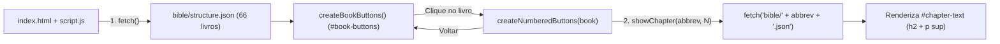

<a id="top"></a>

<div align="center">

<picture>
  <source media="(prefers-color-scheme: dark)" srcset="https://raw.githubusercontent.com/voaneves/bible-app/main/assets/logo/logo-dark.svg" />
  <source media="(prefers-color-scheme: light)" srcset="https://raw.githubusercontent.com/voaneves/bible-app/main/assets/logo/logo-light.svg" />
  
</picture>

<h1>Site da Bíblia</h1>

<p>
  <strong>Leitor da Bíblia no navegador com carregamento sob demanda por livro e capítulo — zero frameworks ou etapa de build.</strong><br />
  <sub>
    66 livros, 1.189 capítulos e 31.123 versículos indexados em JSON —
    <kbd>HTML5</kbd> · <kbd>CSS3</kbd> · <kbd>JavaScript</kbd> · <kbd>Fetch API</kbd>
  </sub>
</p>

<p>
  <a href="https://voaneves.github.io/bible-app/"><picture><source media="(prefers-color-scheme: dark)" srcset="https://raw.githubusercontent.com/voaneves/bible-app/main/assets/buttons/live-dark.svg" /></picture></a>
  <a href="#como-rodar"><picture><source media="(prefers-color-scheme: dark)" srcset="https://raw.githubusercontent.com/voaneves/bible-app/main/assets/buttons/how-dark.svg" /></picture></a>
</p>

<p><sub>Precisa de algo assim? <a href="https://voaneves.com/#contato"><strong>Vamos conversar →</strong></a></sub></p>

<p>
  <a href="https://github.com/voaneves/bible-app/blob/main/LICENSE"></a>
  
  
</p>

<p>
  <a href="#o-que-faz-hoje">O que faz</a> ·
  <a href="#arquitetura">Arquitetura</a> ·
  <a href="#como-rodar">Como rodar</a> ·
  <a href="#estrutura">Estrutura</a> ·
  <a href="#contato">Contato</a>
</p>

</div>

<picture>
  <source media="(prefers-color-scheme: dark)" srcset="https://raw.githubusercontent.com/voaneves/bible-app/main/assets/brand/rule-dark.svg" />
  <source media="(prefers-color-scheme: light)" srcset="https://raw.githubusercontent.com/voaneves/bible-app/main/assets/brand/rule-light.svg" />
  
</picture>

<a id="o-que-faz-hoje"></a>
## O que faz hoje

Escolha um livro da Bíblia, selecione o capítulo desejado e leia os versículos formatados diretamente no navegador sem recarregar a página.

Demonstração ao vivo: <https://voaneves.github.io/bible-app/>

### 66 livros em arquivos individuais

Em vez de carregar os `31.123` versículos de uma só vez na memória, cada livro (`Gen.json` a `Rev.json`) fica isolado sob `bible/`, somando **66** livros e **1.189** capítulos catalogados em [`bible/structure.json`](./bible/structure.json)[^1].

### Navegação dinâmica e `fetch()` sob demanda

Na abertura, [`script.js`](./script.js) lê apenas `bible/structure.json` e gera os botões dos livros (`createBookButtons()`). Somente ao escolher um capítulo a função `showChapter(abbrev, chapterNumber)` busca `bible/${abbrev}.json`, enquanto `createNumberedButtons()` gera a grade `1..N` com botão de retorno.

> [!NOTE]
> A interface em [`index.html`](./index.html) e as mensagens de erro em [`script.js`](./script.js) estão em **português**, enquanto os versículos armazenados nos arquivos JSON em `./bible/` estão em **inglês**.

<a id="arquitetura"></a>
## Arquitetura de carregamento



<a id="como-rodar"></a>
## Como rodar

> [!WARNING]
> **Não abra `index.html` via `file://`.** Navegadores modernos bloqueiam chamadas `fetch("bible/structure.json")` em origem `file://` por política CORS[^2]. Sirva a pasta com qualquer servidor estático HTTP:

```bash
git clone https://github.com/voaneves/bible-app.git
cd bible-app
python -m http.server 8000
```

Acesse `http://localhost:8000`.

<a id="estrutura"></a>
## Estrutura

| Arquivo | Função |
| :--- | :--- |
| [`index.html`](./index.html) | Estrutura da página e contêineres de navegação/leitura |
| [`script.js`](./script.js) | Geração dinâmica de botões e carga sob demanda via `fetch` |
| [`styles.css`](./styles.css) | Grade responsiva de botões e tipografia dos versículos (`<sup>`) |
| `bible/` | `structure.json` e um arquivo `<abbrev>.json` por livro (`chapter > verses`) |

```json
{
  "book": "Genesis",
  "chapters": [
    {
      "chapter": "1",
      "verses": [
        { "verse": "1", "text": "In the beginning God created the heaven and the earth." }
      ]
    }
  ]
}
```

<a id="contato"></a>
## Contato

<p>
  <a href="https://voaneves.com/#contato"><picture><source media="(prefers-color-scheme: dark)" srcset="https://raw.githubusercontent.com/voaneves/bible-app/main/assets/buttons/hire-dark.svg" /></picture></a>
  <a href="https://voaneves.com/"><picture><source media="(prefers-color-scheme: dark)" srcset="https://raw.githubusercontent.com/voaneves/bible-app/main/assets/buttons/site-dark.svg" /></picture></a>
</p>

<a href="https://linkedin.com/in/voaneves">LinkedIn</a> · <a href="mailto:victorneves478@gmail.com">E-mail</a>

<p align="center">
  
</p>

<p align="center"><sub>Licenciado sob a <a href="https://github.com/voaneves/bible-app/blob/main/LICENSE">Licença MIT</a> © 2026 <a href="https://github.com/voaneves">Victor Neves</a> · <strong>VOANEVES.</strong></sub></p>

<p align="center"><sub><a href="#top">↑ Voltar ao topo</a></sub></p>

[^1]: [`bible/structure.json`](./bible/structure.json) registra `book`, `abbrev`, total de capítulos e total de versículos de cada livro.
[^2]: O uso de `http://localhost` ou hospedagem estática (como GitHub Pages) libera a leitura local dos JSONs pela Fetch API.
