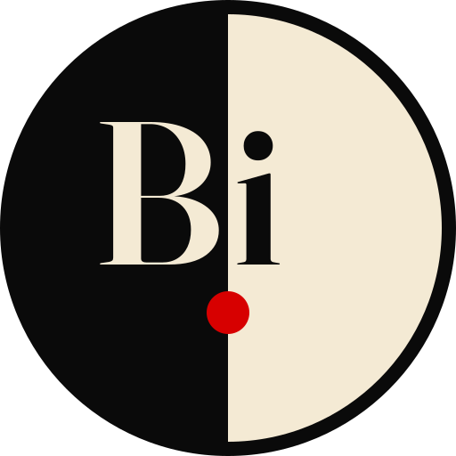

<a id="top"></a>

<div align="center">

<picture>
  <source media="(prefers-color-scheme: dark)" srcset="https://raw.githubusercontent.com/voaneves/bible-app/main/assets/logo/logo-dark.svg" />
  <source media="(prefers-color-scheme: light)" srcset="https://raw.githubusercontent.com/voaneves/bible-app/main/assets/logo/logo-light.svg" />
  
</picture>

<h1>Site da Bíblia</h1>

<p>
  <strong>Leitor da Bíblia no navegador: escolha o livro e o capítulo e leia os versículos.</strong><br />
  <sub>HTML, CSS e JavaScript puros, sem framework nem build</sub>
</p>

<p>
  <a href="https://voaneves.github.io/bible-app/"><picture><source media="(prefers-color-scheme: dark)" srcset="https://raw.githubusercontent.com/voaneves/bible-app/main/assets/buttons/live-dark.svg" /></picture></a>
  <a href="https://github.com/voaneves/bible-app#como-rodar"><picture><source media="(prefers-color-scheme: dark)" srcset="https://raw.githubusercontent.com/voaneves/bible-app/main/assets/buttons/how-dark.svg" /></picture></a>
</p>

<p><sub>Precisa de algo assim? <a href="https://voaneves.com/#contato"><strong>Vamos conversar →</strong></a></sub></p>

<p>
  <a href="https://github.com/voaneves/bible-app/blob/main/LICENSE"></a>
  
</p>

<p>
  <a href="#o-que-faz-hoje">O que faz</a> ·
  <a href="#como-rodar">Como rodar</a> ·
  <a href="#estrutura">Estrutura</a> ·
  <a href="#contato">Contato</a>
</p>

</div>

<picture>
  <source media="(prefers-color-scheme: dark)" srcset="https://raw.githubusercontent.com/voaneves/bible-app/main/assets/brand/rule-dark.svg" />
  <source media="(prefers-color-scheme: light)" srcset="https://raw.githubusercontent.com/voaneves/bible-app/main/assets/brand/rule-light.svg" />
  
</picture>

## O que faz hoje

Escolha um livro da Bíblia, depois um capítulo, e leia os versículos na própria página.

Este é um protótipo feito com HTML, CSS e JavaScript puros, sem frameworks nem build. Os livros e capítulos vêm de arquivos JSON locais. Demonstração: <https://voaneves.github.io/bible-app/>

- Carrega `bible/structure.json` e gera, dinamicamente, um botão por livro.
- Ao clicar num livro, mostra botões numerados com os capítulos, com botão de voltar à lista de livros.
- Ao clicar num capítulo, `showChapter` carrega o JSON do livro e exibe os versículos do capítulo abaixo dos botões.

## Como rodar

O app usa `fetch` para ler os JSON, então precisa de um servidor estático (abrir o `index.html` direto via `file://` não funciona):

```bash
gh repo clone voaneves/bible-app
cd bible-app
python -m http.server 8000
```

Acesse http://localhost:8000.

## Estrutura

```
index.html   página
script.js    botões de livros e capítulos, e exibição dos versículos
styles.css   estilos
bible/       structure.json (livros e nº de capítulos) e um JSON por livro
LICENSE
```

Cada JSON de livro segue o formato `livro > capítulos > versículos` (`verse`, `text`); os textos em `bible/` estão em inglês.

## Stack e aprendizados

HTML5, CSS3, JavaScript (DOM, `fetch`, geração dinâmica de elementos) e dados em JSON.

## Contato

<p>
  <a href="https://voaneves.com/#contato"><picture><source media="(prefers-color-scheme: dark)" srcset="https://raw.githubusercontent.com/voaneves/bible-app/main/assets/buttons/hire-dark.svg" /></picture></a>
  <a href="https://voaneves.com/"><picture><source media="(prefers-color-scheme: dark)" srcset="https://raw.githubusercontent.com/voaneves/bible-app/main/assets/buttons/site-dark.svg" /></picture></a>
</p>

<a href="https://linkedin.com/in/voaneves">LinkedIn</a> · <a href="mailto:victorneves478@gmail.com">E-mail</a>

<p align="center">
  
</p>

<p align="center"><sub>Licenciado sob a <a href="https://github.com/voaneves/bible-app/blob/main/LICENSE">Licença MIT</a>.</sub></p>

<p align="center"><sub><a href="#top">↑ Voltar ao topo</a></sub></p>
